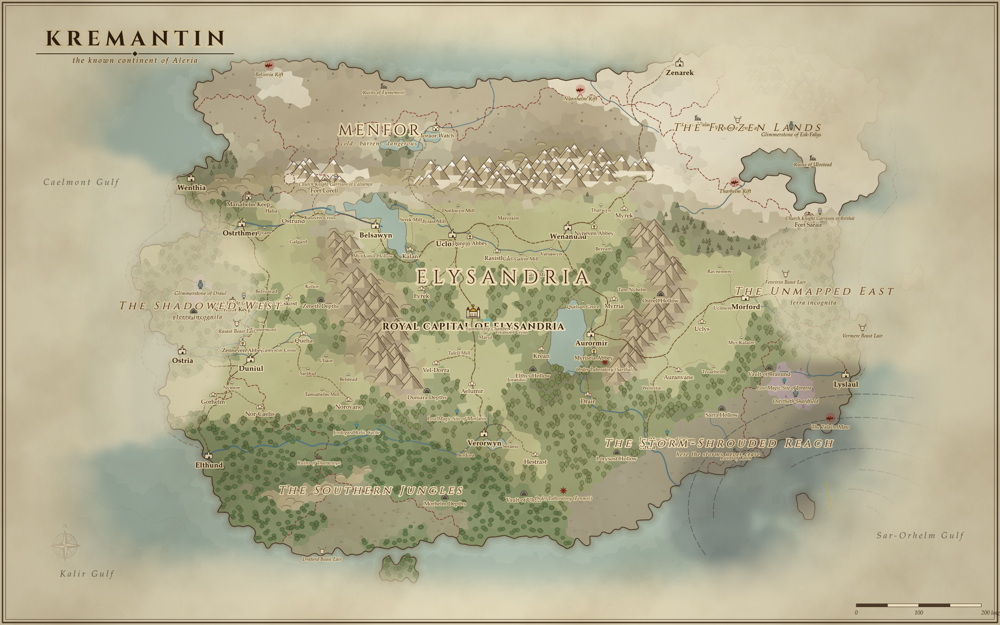

# Aleria Map Generator

A browser-based fantasy map generator and editor for **Kremantin**, the known continent of **Aleria** in
*A Guide for Heroes (Who'd Rather Not Be)*. The default **lore mode** always builds a recognisable Kremantin:

- **Elysandria** in the centre, with the Royal Capital and its palace-temple
- the cold wastes of **Menfor** to the north, behind a mountain wall
- the **Frozen Lands** in the north-east
- the **Southern Jungles**
- the **Storm-Shrouded Reach** in the south-east
- the Shadowed West and the Unmapped East fading into fog at the edges of the known world

The map is different for every seed. Freeform mode makes ordinary fantasy worlds in four shapes: continent, twin continents, pangea and archipelago.

It is pure static HTML/CSS/JavaScript: ES modules, no build step and no server code. It works offline.



## Run it locally

Browsers block ES modules on `file://`, so serve the folder with any static web server:

```bash
cd aleria-map-generator
python3 -m http.server 8000
# then open http://localhost:8000
```

`npx serve .` or the VS Code "Live Server" extension work just as well.

## Features

**Generation**
- Voronoi cell mesh: jittered points triangulated with d3-delaunay, 2k–30k cells.
- Seeded RNG, so the same seed always gives the same map.
- Heightmap built from blobs, mountain ridges, fBm and ridged noise.
- Climate: temperature with altitude lapse, and moisture with coastal effects.
- 18 biomes.
- Hydrology: depression filling, lakes, flux-based rivers with widths, and named major rivers.
- Settlements by habitability, with Algon-flavoured names (or your own names list).
- States and kingdoms grown by terrain-cost expansion.
- Roads (A\*), trade routes (MST) and sea lanes.
- Lore markers: Church of Ucliat strongholds, Order of Knights garrisons, dungeons, ruins, relic sites, Lumenari sites, Doomsday breaches, monster lairs and summoning circles. Crimson Labyrinth entrances are a hidden layer.
- Mana, threat, religion, race and "known world" fields.

**Editor**
- Dark UI with zoom (wheel, pinch, buttons), pan, minimap, status bar, tooltips and toasts.
- Undo/redo (Ctrl+Z / Ctrl+Y), with 50 steps.
- Autosave to `localStorage`, plus "Restore last autosave".
- 14 tools:
  - select/move (Shift+drag for box select, Q/E rotate, Alt+wheel scale)
  - pan
  - raise, lower and smooth terrain
  - biome paint
  - zone paint (state, religion, race, known world, Doomsday threat, mana)
  - place settlement or marker
  - route or border drawing, optionally auto-routed around terrain
  - river drawing
  - text labels
  - freehand drawing
  - stamp
  - erase
- The Inspector edits names, sizes, colours and lore notes for features, labels, stamps, lines, rivers, drawings, cells, regions and states (with rulers).
- Layers panel: toggle every layer and lore overlay, set overlay opacity, and edit the state, religion and race legends.

**Styles and assets**
- Five presets: Classic Parchment, Parchment & Ink, Modern Clean, Dark / Stormy and High Contrast.
- Colour controls for land, water and borders, plus fonts and effects (hillshade, paper texture, vignette, coast ripples).
- 28 original SVG icons drawn for this project.
- Upload your own PNG, JPG or SVG stamps. They are saved inside the project file.

**Overlays**
- political, religious, races, Doomsday breach zones, Lumenari sites, dungeon/relic sites, trade routes, mana density
- **Hero's View** (F): the known world is clear and everything else sinks into fog
- cell grid

**Export and sharing**
- PNG at 1920–7680 px wide (8K).
- Vector SVG.
- PDF (A4, A3, A2 or fit-to-map), made with jsPDF.
- Project JSON save and open (Ctrl+S / Ctrl+O). It keeps all hand edits.
- **Share link:** the URL hash carries the seed, settings, style and overlays, e.g. `#seed=kremantin&lore=1&style=ink`.
- **Embed snippet:** an `<iframe>` with `&embed=1`, a chrome-less view with pan and zoom.

Keyboard help is under **?** in the app.

## Project structure

```
index.html          app shell (top bar, tools, canvas, side panels, status bar)
css/style.css       dark theme + responsive + embed mode
js/main.js          app state, input, tools, panels, history, autosave, modals
js/generator.js     world generation: mesh, heightmap, climate, hydrology, biomes, populate()
js/render.js        map renderer (layer order, overlays, coastlines, relief, labels)
js/painter.js       Canvas and SVG painter back-ends with one shared drawing API
js/styles.js        style presets, palettes, fonts
js/assets.js        original SVG icon library, feature kinds, custom asset store
js/names.js         Algon-flavoured name generator
js/biomes.js        biome table
js/io.js            JSON save/load, PNG/SVG/PDF export, share-link hash
js/rng.js, color.js seeded RNG, noise, heap, colour helpers
vendor/             d3-delaunay (+ delaunator) and jsPDF, with their licenses
screenshots/        example renders
```

## How to modify

- **Lore layout:**
  - Region anchors, climates and descriptions are in `LORE_REGIONS` in `js/generator.js`.
  - The landmass blobs and mountain ridges are at the top of `heightmap()`, in the `if (S.lore)` branch.
- **Lore content:**
  - States and rulers are in `stateDefs` inside `populate()`.
  - Religions and races are in `RELIGIONS_DEFAULT` and `RACES_DEFAULT`.
  - Marker counts and placement rules are in the "lore markers" section of `populate()`.
- **Names:** use the syllable tables in `js/names.js`, or paste a list into **World → Custom place names** (one per line). You can also import a `.txt` or `.json` list, for example names copied from the fandom wiki.
- **New icon:** add an entry to `ASSETS` in `js/assets.js` as a 64×64 SVG fragment. Colour placeholders (`I`, `F`, `A`, …) follow the active style. To make it placeable, add it to `FEATURE_KINDS`.
- **New style:** add a preset to `STYLE_PRESETS` (and optionally `ICON_PALETTES`) in `js/styles.js`.
- **New biome:** add it to `js/biomes.js`, give it colours in `styles.js` and add a rule in `biomeFor()` in `generator.js`.
- **New overlay:** add it to `OVERLAY_LIST` and draw it in `overlayGroups()` / `renderMap()` in `js/render.js`.

## Deploy to GitHub Pages

1. Create a GitHub repository and add the contents of this folder at the repo root (the `.nojekyll` file is included).
2. Commit and push to `main`.
3. In the repository, go to **Settings → Pages → Build and deployment**. Choose **Deploy from a branch**, branch `main`, folder `/ (root)`, and save.
4. After a minute the app is live at `https://<user>.github.io/<repo>/`. Share links and embeds use that URL automatically.

Any other static host works too (Netlify, Cloudflare Pages, itch.io HTML upload, or a plain web server).

## Credits and licenses

- Code and SVG icons are original work for this project. No code from other map generators is used.
- [d3-delaunay](https://github.com/d3/d3-delaunay) and [delaunator](https://github.com/mapbox/delaunator): ISC license (see `vendor/`).
- [jsPDF](https://github.com/parallax/jsPDF): MIT license (see `vendor/`).
- *A Guide for Heroes (Who'd Rather Not Be)* setting names belong to their author. This is a fan tool.
